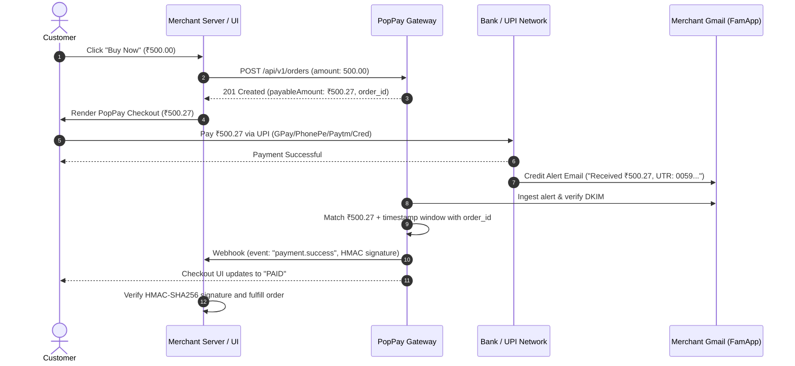

# PopPay · Developer Integration & Architecture Guide

Welcome to the **PopPay Developer Guide**. PopPay is a modern, non-custodial UPI payment gateway designed for independent developers and businesses. Funds move directly from the customer’s UPI app to the merchant’s own bank/UPI handle. PopPay never holds, intercepts, or routes your funds.

---

## 📑 Table of Contents

1. [Architecture & Flow](#1-architecture--flow)
2. [Credentials & Security](#2-credentials--security)
3. [Quickstart in 3 Minutes](#3-quickstart-in-3-minutes)
4. [Order Creation API](#4-order-creation-api)
5. [Frontend Checkout Integration](#5-frontend-checkout-integration)
   - [Option A: Drop-in SDK Modal](#option-a-drop-in-sdk-modal-recommended)
   - [Option B: Hosted Checkout Page](#option-b-hosted-checkout-page)
   - [Option C: Headless / Direct UPI Link](#option-c-headless--direct-upi-link)
6. [Server-Side Payment Verification](#6-server-side-payment-verification)
7. [Webhooks & Idempotency](#7-webhooks--idempotency)
8. [Local Testing & Payment Simulation](#8-local-testing--payment-simulation)
9. [Troubleshooting & Best Practices](#9-troubleshooting--best-practices)

---

## 1. Architecture & Flow

PopPay utilizes a high-efficiency matching engine combining unique dynamic order amounts and automated Gmail credit alerts (FamApp / UPI notifications) with cryptographic DKIM validation.



### Key Concept: Unique Amount Allocation (`payableAmount`)
To distinguish concurrent payments without requiring customers to manually enter memos, PopPay dynamically assigns a small paise suffix (e.g., base `₹500.00` becomes `₹500.27`).
* Always charge and display `order.payableAmount`, never the requested `baseAmount`.
* Orders expire after 10 minutes if unpaid.

---

## 2. Credentials & Security

During account onboarding or via **Dashboard → Settings → Credentials**, you receive:

| Credential | Prefix | Purpose | Environment |
|---|---|---|---|
| **Public Key** | `pp_live_...` | Merchant identifier for frontend SDK | Client-side safe |
| **Secret Key** | `pp_secret_...` | Authenticates `/api/v1/orders` requests | **Server-only** |
| **Signing Secret** | `pp_sign_...` | Validates payment status signatures | **Server-only** |
| **Webhook Secret** | `whsec_...` | Verifies `X-PopPay-Signature` on incoming webhooks | **Server-only** |

> [!CAUTION]
> Never expose `POPPAY_SECRET_KEY`, `POPPAY_SIGNING_SECRET`, or `POPPAY_WEBHOOK_SECRET` in client-side code, git repositories, or mobile bundles.

---

## 3. Quickstart in 3 Minutes

### 1. Store Credentials in `.env`
```env
POPPAY_BASE_URL="http://localhost:5000"     # Or your production domain
POPPAY_PUBLIC_KEY="pp_live_..."
POPPAY_SECRET_KEY="pp_secret_..."
POPPAY_SIGNING_SECRET="pp_sign_..."
POPPAY_WEBHOOK_SECRET="whsec_..."
```

---

## 4. Order Creation API

### Request
`POST /api/v1/orders`

Headers:
```http
Authorization: Bearer <POPPAY_SECRET_KEY>
Content-Type: application/json
```

Payload:
```json
{
  "amount": "499.00",
  "receipt": "order_rcpt_1024",
  "redirectUrl": "https://yourshop.com/order/success"
}
```

### Code Examples

#### Node.js
```javascript
const response = await fetch(`${process.env.POPPAY_BASE_URL}/api/v1/orders`, {
  method: 'POST',
  headers: {
    'Authorization': `Bearer ${process.env.POPPAY_SECRET_KEY}`,
    'Content-Type': 'application/json',
  },
  body: JSON.stringify({
    amount: '499.00',
    receipt: `rcpt_${Date.now()}`,
    redirectUrl: 'https://myshop.com/thank-you',
  }),
});

const order = await response.json();
console.log('Order created:', order.order_id);
console.log('Exact amount to collect:', order.payableAmount);
```

#### Python
```python
import os
import requests

response = requests.post(
    f"{os.environ['POPPAY_BASE_URL']}/api/v1/orders",
    headers={
        "Authorization": f"Bearer {os.environ['POPPAY_SECRET_KEY']}",
        "Content-Type": "application/json",
    },
    json={
        "amount": "499.00",
        "receipt": "rcpt_1001",
        "redirectUrl": "https://myshop.com/thank-you",
    },
)
response.raise_for_status()
order = response.json()
print("Order ID:", order["order_id"])
print("Payable Amount:", order["payableAmount"])
```

#### PHP
```php
<?php
$ch = curl_init(getenv('POPPAY_BASE_URL') . '/api/v1/orders');
curl_setopt_array($ch, [
    CURLOPT_RETURNTRANSFER => true,
    CURLOPT_POST => true,
    CURLOPT_HTTPHEADER => [
        'Authorization: Bearer ' . getenv('POPPAY_SECRET_KEY'),
        'Content-Type: application/json'
    ],
    CURLOPT_POSTFIELDS => json_encode([
        'amount' => '499.00',
        'receipt' => 'rcpt_1001',
        'redirectUrl' => 'https://myshop.com/thank-you'
    ])
]);
$order = json_decode(curl_exec($ch), true);
curl_close($ch);
echo "Order: " . $order['order_id'];
```

#### cURL
```bash
curl -X POST "http://localhost:3001/api/v1/orders" \
  -H "Authorization: Bearer $POPPAY_SECRET_KEY" \
  -H "Content-Type: application/json" \
  -d '{
    "amount": "499.00",
    "receipt": "rcpt_1001",
    "redirectUrl": "https://myshop.com/thank-you"
  }'
```

### Response (`201 Created`)
```json
{
  "order_id": "order_7A0SnT-Mr-S3",
  "baseAmount": "499.00",
  "payableAmount": "499.18",
  "status": "PENDING",
  "expiresAt": "2026-10-18T03:15:00.000Z",
  "checkoutUrl": "/pay/order_7A0SnT-Mr-S3"
}
```

---

## 5. Frontend Checkout Integration

### Option A: Drop-in SDK Modal (Recommended)

Include the lightweight `<script src="/checkout.js"></script>`:

```html
<button id="pay-btn">Pay Now</button>

<script src="https://your-poppay-domain.com/checkout.js"></script>
<script>
  document.getElementById('pay-btn').addEventListener('click', async () => {
    // 1. Create order on your backend
    const res = await fetch('/create-order', { method: 'POST' });
    const order = await res.json();

    // 2. Open PopPay modal
    const checkout = new PopPay({
      key: 'pp_live_YOUR_PUBLIC_KEY',
      order_id: order.order_id,
      name: 'My Store',
      handler: async (payment) => {
        // 3. Verify signature on your server
        const verifyRes = await fetch('/verify-payment', {
          method: 'POST',
          headers: { 'Content-Type': 'application/json' },
          body: JSON.stringify(payment)
        });
        const result = await verifyRes.json();
        if (result.verified) {
          alert('Payment Successful!');
          window.location.href = '/order-confirmed';
        }
      },
      onDismiss: () => {
        console.log('Customer closed the payment window');
      }
    });
    checkout.open();
  });
</script>
```

### Option B: Hosted Checkout Page
Redirect the customer directly to:
```
https://your-poppay-domain.com/pay/{order_id}
```
Upon payment completion, PopPay will redirect back to the `redirectUrl` specified during order creation.

---

## 6. Server-Side Payment Verification

When a payment succeeds, the frontend receives:
```json
{
  "order_id": "order_7A0SnT-Mr-S3",
  "payment_id": "6ad42d8d2b5c06d1e98b5bd0",
  "utr": "005983102475",
  "signature": "b1518d0c011ffb88cfe5e02a1167fb21d04a8dcd6ce2985a7fe09b10fe50b2fe"
}
```

### Verification Algorithm
```
signature = HMAC_SHA256(key = POPPAY_SIGNING_SECRET, message = "{order_id}|{payment_id}")
```

#### Node.js
```javascript
const crypto = require('crypto');

function verifyPayment(orderId, paymentId, signature) {
  const expected = crypto
    .createHmac('sha256', process.env.POPPAY_SIGNING_SECRET)
    .update(`${orderId}|${paymentId}`, 'utf8')
    .digest();

  let supplied;
  try {
    supplied = Buffer.from(signature, 'hex');
  } catch {
    return false;
  }

  return supplied.length === expected.length && crypto.timingSafeEqual(supplied, expected);
}
```

#### Python
```python
import hmac
import hashlib

def verify_payment(order_id: str, payment_id: str, signature: str, secret: str) -> bool:
    message = f"{order_id}|{payment_id}".encode("utf-8")
    expected = hmac.new(secret.encode("utf-8"), message, hashlib.sha256).hexdigest()
    return hmac.compare_digest(signature.lower(), expected.lower())
```

---

## 7. Webhooks & Idempotency

PopPay delivers real-time HTTPS webhooks for confirmed payments.

### Verifying Webhook Signatures
Incoming requests contain the header:
```
X-PopPay-Signature: <64-character-hex-digest>
```
The signature is computed over the **raw request body buffer** using `POPPAY_WEBHOOK_SECRET`.

#### Express Webhook Example
```javascript
app.post('/webhook', express.raw({ type: 'application/json' }), (req, res) => {
  const signature = req.get('X-PopPay-Signature') || '';
  const expected = crypto
    .createHmac('sha256', process.env.POPPAY_WEBHOOK_SECRET)
    .update(req.body)
    .digest();

  const supplied = Buffer.from(signature, 'hex');
  if (supplied.length !== expected.length || !crypto.timingSafeEqual(supplied, expected)) {
    return res.status(401).json({ error: 'Invalid signature' });
  }

  const payload = JSON.parse(req.body.toString('utf8'));
  if (payload.event === 'payment.success') {
    const { order_id, payment_id, utr, amount } = payload.data;
    // Idempotently fulfill order
  }

  return res.json({ received: true });
});
```

---

## 8. Local Testing & Payment Simulation

In development (`NODE_ENV !== 'production'`), you can simulate instant payments without making real bank transactions:

```bash
curl -X POST http://localhost:3001/api/v1/dev/simulate-payment \
  -H "Authorization: Bearer <MERCHANT_JWT_TOKEN>" \
  -H "Content-Type: application/json" \
  -d '{"order_id": "order_XXXXXX"}'
```

This immediately satisfies the order, triggers webhooks, and updates the open checkout modal to "Payment Confirmed".

---

## 9. Troubleshooting & Best Practices

1. **Exact Amount Matching**:
   Customers must pay the exact amount including paise (e.g., ₹499.27). Any amount deviation is flagged as `UNMATCHED` to protect against under/over payments.
2. **Auto-Reconciliation**:
   PopPay's background worker scans every 10 seconds. Any unmatched payments are automatically reconciled against active pending orders.
3. **DKIM Strictness**:
   FamApp payment alert emails are validated cryptographically against `famapp.in` DKIM records. Manual forwards from personal Gmail accounts will fail verification by design.
